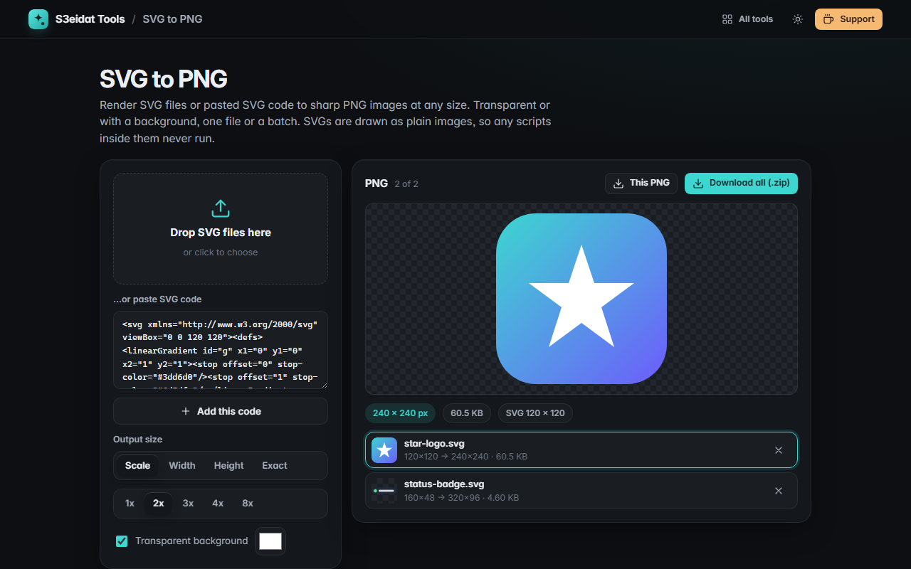

# SVG to PNG

> Render SVG files or SVG code to sharp PNG images at any size. Free, private, and it runs entirely in your browser.

### ▶ [Open SVG to PNG](https://s3eidat.github.io/svg-to-png/)



## Features

- Drop **SVG files** or **paste SVG code**
- Output size by **scale (1x, 2x, 3x, 4x, 8x)**, **width**, **height** or an **exact width × height**
- Rendered at the target size, so a 24 px icon at 8x is sharp, not blurry
- **Transparent** background or any **background color**
- Understands `width`/`height` in px, pt, pc, mm, cm and in, and SVGs that only have a `viewBox`
- **Batch**: many SVGs at once, download one PNG or **all as a .zip**
- **Safe by design**: SVGs are drawn only as images (`` from a blob URL), never inserted into the page,
  so scripts and event handlers inside an SVG never run and external references are never loaded

## Privacy


Your files never leave your device. There is no server, no account, no analytics.
The page ships with a strict Content-Security-Policy (`connect-src 'self'`), so the browser
itself blocks any attempt to send data anywhere.

## Run it yourself

It's plain HTML, CSS and JavaScript with no build step:

```bash
git clone https://github.com/s3eidat/svg-to-png
cd svg-to-png
python -m http.server 8000
```

Then open http://localhost:8000.

## Support

If this saved you time, **[buy me a coffee ☕](https://s3eidat.github.io/coffee/)**. It keeps every tool free.

---

Part of **[S3eidat Tools](https://s3eidat.github.io/)**: 100+ free, private tools that run in your browser. MIT licensed.
